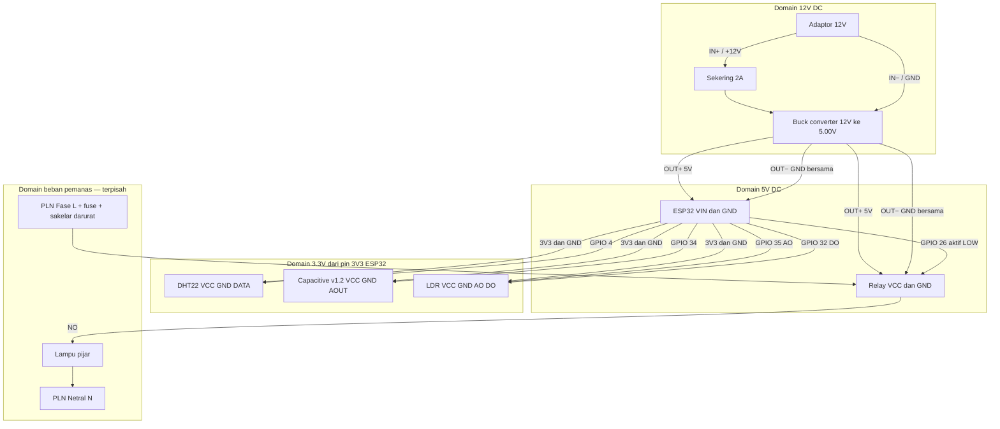

# Wiring Pengering Gabah (ESP32)

Dokumen ini untuk **menggambar diagram nantinya** (Fritzing, diagrams.net, EasyEDA). Ikuti **satu persatu kabel**. Jangan mencampur domain 12V, 5V, 3.3V, dan AC 220V.

Firmware yang jadi acuan pin: `program_esp.ino`

```cpp
PIN_DHT        = GPIO 4
PIN_MOISTURE   = GPIO 34    // ADC1 analog
PIN_LDR_AO     = GPIO 35    // ADC1 analog
PIN_LDR_DO     = GPIO 32
PIN_RELAY      = GPIO 26    // aktif LOW
```

---

## 1. Daftar komponen (domain daya)

Ada **empat domain listrik**. Gambar dengan warna berbeda.

| Domain | Tegangan | Untuk apa | Warna saran saat menggambar |
|---|---|---|---|
| A. Sumber | **12V DC** | Adaptor/baterai 12V ke input buck | Merah tebal (+) / hitam tebal (−) |
| B. Logika daya | **5V DC** | Output buck → ESP32 VIN, VCC modul relay | Merah |
| C. Sensor | **3.3V DC** | Output pin `3V3` ESP32 → semua sensor | Oranye |
| D. Beban pemanas | **AC 220V** (atau 12V lampu, lihat §7) | Hanya melalui COM/NO relay | Cokelat / biru (fase/netral) — **jangan campur dengan A–C** |

**Aturan mutlak**

1. **12V tidak boleh** masuk ke pin `3V3`, GPIO, DHT22, capacitive moisture, atau LDR.
2. **5V tidak boleh** masuk ke pin `3V3` ESP32, dan **jangan** menyuplai capacitive soil moisture v1.2 (ADC ESP32 max ~3.3V; 5V merusak pin).
3. Semua GND **sisi DC** harus **satu titik** (common ground): `OUT−` buck = `GND` ESP32 = `GND` semua modul.
4. GND AC 220V / earth **tidak disambung** ke GND ESP, kecuali Anda sengaja merancang isolasi + earth chassis terpisah. Untuk prototipe: **GND DC dan netral/earth AC terpisah**.
5. Relay memisahkan sisi kendali (GPIO) dan sisi lampu. Kabel lampu **hanya** ke sekrup COM/NO, bukan ke ESP.

---

## 2. Penurun tegangan 12V → 5V (buck / step-down)

Modul umum: LM2596, Mini360, MP1584, atau adaptor 12V + buck 5A.

### Pin modul buck (nama bisa tertulis `IN+ IN− OUT+ OUT−` atau `VIN GND VOUT GND`)

| Pin buck | Arti | Disambung ke |
|---|---|---|
| **IN+** / VIN | Masukan positif | **+12V** adaptor/baterai |
| **IN−** / GND in | Masukan negatif | **−12V** / GND adaptor |
| **OUT+** / VOUT | Keluaran 5V | **VIN (5V)** ESP32 + **VCC** modul relay |
| **OUT−** / GND out | GND keluaran | **GND ESP32** + GND semua modul DC |

### Langkah setel tegangan (wajib sebelum menyambung ESP)

1. Sambungkan **hanya** 12V ke `IN+` / `IN−`. ESP dan sensor **belum** dipasang.
2. Ukur `OUT+` ke `OUT−` dengan multimeter.
3. Putar trimpot sampai **5.00 V** (aman 4.9–5.1 V). Jangan di atas 5.5 V.
4. Baru kemudian sambungkan `OUT+` ke ESP32.

### Proteksi yang disarankan di gambar

```
+12V ── [sekering 2A] ── IN+ buck
−12V ──────────────────── IN− buck
```

- Polaritas: `+` 12V ke `IN+` saja. Terbalik bisa merusak buck.
- Jangan pakai linear 12V→5V (7805) tanpa heatsink besar; panas tinggi.

### Perkiraan arus (cukup buck ≥ 2A)

| Beban | Perkiraan |
|---|---|
| ESP32 + WiFi | 0.15–0.4 A @ 5V |
| DHT22 + LDR + capacitive | < 50 mA @ 3.3V (dari regulator onboard ESP) |
| Koil relay 1 channel | ~70–80 mA @ 5V |
| **Total 5V** | ≈ 0.5 A, sisakan cadangan → buck **2A–3A** |

Lampu pijar **tidak** mengambil daya dari 5V (kecuali Anda memakai lampu 12V, lihat §7).

---

## 3. Menyuplai ESP32 dari 5V

Papan: **ESP32 DevKit** (30-pin atau 38-pin). Cari label silkscreen, jangan mengandalkan posisi kiri/kanan saja.

| Kabel dari | Pin ESP32 | Fungsi |
|---|---|---|
| Buck **OUT+** (5V) | **`VIN`** atau pin bertuliskan **`5V`** | Masuk regulator onboard → menghasilkan 3.3V internal |
| Buck **OUT−** | **`GND`** (salah satu GND cukup, lebih baik dua GND jumper ke bus GND) | Common ground |

**Jangan**

- Menyuntik 5V ke pin **`3V3`** (itu keluaran regulator, bukan input 5V).
- Menyambung USB komputer dan VIN 5V bersamaan dalam waktu lama (dua sumber 5V). Saat upload program: cabut VIN atau cabut USB, pilih satu.

Alur daya yang benar:

```
12V adaptor
   → buck 5V
      → VIN ESP32
         → regulator onboard
            → pin 3V3  → sensor
```

---

## 4. Bus daya yang harus ada di diagram

Gambar tiga rel (rail) horizontal:

```
Rel 12V+     hanya ke IN+ buck (+ sekering)
Rel 5V+      dari OUT+ buck → VIN ESP32, VCC relay
Rel 3V3+     dari pin 3V3 ESP32 → VCC DHT22, VCC capacitive, VCC LDR
Rel GND DC   dari OUT− buck → GND ESP32 → GND DHT22, GND capacitive, GND LDR, GND relay
```

Semua sensor **share GND** dengan ESP32. Tanpa common ground, pembacaan analog (GPIO 34/35) salah atau tidak stabil.

---

## 5. Sensor — sambungan pin per pin

Semua VCC sensor dari **`3V3` ESP32**, bukan dari 5V buck.

### 5.1 DHT22 (suhu ruang + kelembapan udara)

Modul 3 pin atau 4 pin (NC tidak dipakai).

| Pin DHT22 | Ke | Keterangan |
|---|---|---|
| **VCC** / + | ESP32 **`3V3`** | Boleh 3.3V. Jangan 12V. |
| **DATA** / OUT | ESP32 **GPIO 4** | Kabel sinyal tunggal |
| **GND** / − | ESP32 **`GND`** | Common ground |
| NC (jika ada) | tidak disambung | — |

Jika memakai **sensor DHT22 telanjang** (bukan modul), pasang resistor **4.7 kΩ – 10 kΩ** dari DATA ke 3V3 (pull-up). Modul siap pakai biasanya sudah ada pull-up di PCB.

Firmware: `DHT dht(4, DHT22);`

### 5.2 Capacitive soil moisture sensor v1.2 (kelembapan gabah)

Tiga pin: `VCC`, `GND`, `AOUT`. Versi v1.2 **analog**.

| Pin sensor | Ke | Keterangan |
|---|---|---|
| **VCC** | ESP32 **`3V3` saja** | Wajib 3.3V. **Dilarang 5V** (AOUT bisa > 3.3V → merusak GPIO 34) |
| **GND** | ESP32 **`GND`** | Common ground |
| **AOUT** | ESP32 **GPIO 34** | Analog ADC1. Tidak ada pin digital di firmware |

GPIO 34 adalah **input-only** (tidak ada output internal). Cocok untuk ADC, tidak untuk LED/relay.

Letakkan probe di tumpukan gabah, bukan di air mengalir. Jangan celupkan bagian elektronik PCB.

### 5.3 LDR modul 4 pin

Pin tipikal: `VCC`, `GND`, `AO`, `DO`.

| Pin LDR | Ke | Keterangan |
|---|---|---|
| **VCC** | ESP32 **`3V3`** | Jangan 12V |
| **GND** | ESP32 **`GND`** | Common ground |
| **AO** (analog) | ESP32 **GPIO 35** | Intensitas cahaya (ADC1) |
| **DO** (digital) | ESP32 **GPIO 32** | HIGH = gelap (potensiometer di modul mengatur ambang) |

GPIO 35 juga **input-only**. Potensiometer di modul LDR hanya memengaruhi `DO`, bukan rumus `AO` di firmware.

---

## 6. Modul relay (kendali pemanas)

Firmware: GPIO **26**, **aktif LOW** (`RELAY_ACTIVE_LOW = true`). Artinya GPIO 26 = **LOW** → relay **ON** (lampu nyala).

### 6.1 Sisi kendali (low voltage) — 5 pin / 6 pin umum

| Pin relay | Ke | Keterangan |
|---|---|---|
| **VCC** | Buck **OUT+ (5V)** | Koil + optocoupler. Modul 5V jangan dipaksa 3.3V jika tidak mau klik |
| **GND** | **GND DC** (sama dengan ESP) | Wajib common ground |
| **IN** / IN1 | ESP32 **GPIO 26** | Sinyal kendali 3.3V, aktif LOW |

Jika ada jumper **JD-VCC**:

| Kondisi | Artinya | Untuk prototipe ini |
|---|---|---|
| Jumper JD-VCC terpasang | VCC koil = VCC logika (satu 5V) | **Pakai cara ini** (paling sederhana) |
| Jumper dilepas | Isolasi opto: JD-VCC = 5V koil, VCC = 3.3V logika | Opsional, lebih aman dari noise |

Untuk gambar pertama: **jumper terpasang**, `VCC` relay ke 5V buck, `GND` ke GND bersama, `IN` ke GPIO 26.

LED indikator relay biasanya menyala saat **aktif**. Cocokkan dengan `heaterOn` di Serial/aplikasi.

### 6.2 Sisi beban (sekrup COM / NO / NC) — terpisah total dari ESP

| Sekrup | Arti | Sambungan lampu pijar 220V |
|---|---|---|
| **COM** | Kutub bersama sakelar | Satu kaki dari **fase (L)** PLN, lewat sakelar/fuse |
| **NO** (Normally Open) | Tertutup hanya saat relay ON | Ke salah satu kaki **lampu**. Kaki lampu lain ke **netral (N)** |
| **NC** (Normally Closed) | Tertutup saat relay OFF | **Tidak dipakai** (kosong) |

Alur AC yang benar (pemanas ON hanya saat GPIO 26 LOW):

```
PLN Fase (L) ── [sakelar mekanik OFF darurat] ── [fuse] ── COM relay
NO relay ── kaki 1 lampu pijar
kaki 2 lampu pijar ── Netral (N) PLN
```

Saat relay OFF, COM–NO terbuka → lampu mati. Saat ON, COM–NO terhubung → lampu nyala.

**Jangan** menyambungkan COM/NO ke GPIO, 3V3, 5V, atau 12V DC.

---

## 7. Jika pemanas lampu 12V (bukan 220V)

Jika nanti lampu pijar/halogen **12V** (bukan PLN):

```
+12V adaptor ── COM relay
NO relay ── kaki + lampu 12V
kaki − lampu 12V ── GND 12V (IN− buck / − adaptor)
```

Catatan:

- Arus lampu 12V besar (contoh 20 W ≈ 1.7 A). Pilih relay sesuai arus, kabel tebal, fuse di +12V **sebelum** cabang ke lampu dan ke buck.
- Cabang: `+12V` → (a) IN+ buck untuk elektronika, (b) COM relay untuk lampu. Jangan mengalirkan arus lampu lewat PCB ESP.

---

## 8. Diagram blok (untuk disalin ke gambar)

```text
                    ┌────────── Adaptor / baterai 12V DC ──────────┐
                    │  +12V                              GND 12V   │
                    └───┬──────────────────────────────────┬───────┘
                        │                                  │
                   [fuse 2A]                               │
                        │                                  │
                        ▼                                  ▼
                  ┌───────────┐                      (IN− / GND)
                  │  BUCK     │
                  │  12V→5.00V│
                  │ IN+   IN− │
                  │ OUT+  OUT−│
                  └─┬──────┬──┘
                    │5V    │GND DC  ←── semua GND modul bertemu di sini
                    │      │
         ┌──────────┼──────┼──────────────────────────────────┐
         │          │      │           ESP32 DevKit           │
         │          ▼      ▼                                  │
         │        VIN     GND                                 │
         │        3V3 ──┬──────────────┬──────────────┐       │
         │              │              │              │       │
         │            DHT22      Capacitive v1.2    LDR 4pin  │
         │            VCC            VCC             VCC      │
         │            GND            GND             GND      │
         │            DATA──GPIO4    AOUT──GPIO34    AO─GPIO35│
         │                                           DO─GPIO32│
         │                                                    │
         │        GPIO26 ─────────────────────────────────┐   │
         └────────────────────────────────────────────────┼───┘
                                                          │
                                              ┌───────────▼──┐
                                              │ RELAY 5V     │
                                              │ VCC ← 5V     │
                                              │ GND ← GND DC │
                                              │ IN  ← GPIO26 │
                                              │ COM  NO  NC  │
                                              └──┬────┬──────┘
                                                 │    │
                                            Fase L   ke lampu
                                                 │    │
                                              [lampu pijar]
                                                 │
                                              Netral N
```

### Mermaid (bisa di-render di GitHub / VS Code)



---

## 9. Tabel master semua kabel (salin ke legend gambar)

Nomor urut = urutan menyolder/jumper yang disarankan: daya dulu, sensor, baru AC.

| No | Dari | Ke | Tegangan | Fungsi |
|---|---|---|---|---|
| 1 | Adaptor +12V | Sekering 2A → **IN+** buck | 12V | Masukan buck |
| 2 | Adaptor −12V / GND | **IN−** buck | 0V | GND masukan |
| 3 | **OUT+** buck | ESP32 **VIN / 5V** | 5V | Daya ESP |
| 4 | **OUT−** buck | ESP32 **GND** | 0V | GND ESP |
| 5 | **OUT+** buck | Relay **VCC** | 5V | Daya koil relay |
| 6 | **OUT−** buck / GND ESP | Relay **GND** | 0V | GND relay |
| 7 | ESP32 **3V3** | DHT22 **VCC** | 3.3V | Daya DHT22 |
| 8 | ESP32 **GND** | DHT22 **GND** | 0V | GND DHT22 |
| 9 | ESP32 **GPIO 4** | DHT22 **DATA** | 3.3V logika | Suhu & RH |
| 10 | ESP32 **3V3** | Capacitive **VCC** | 3.3V | Daya probe gabah |
| 11 | ESP32 **GND** | Capacitive **GND** | 0V | GND probe |
| 12 | ESP32 **GPIO 34** | Capacitive **AOUT** | analog ≤ 3.3V | Kelembapan gabah |
| 13 | ESP32 **3V3** | LDR **VCC** | 3.3V | Daya LDR |
| 14 | ESP32 **GND** | LDR **GND** | 0V | GND LDR |
| 15 | ESP32 **GPIO 35** | LDR **AO** | analog ≤ 3.3V | Intensitas cahaya |
| 16 | ESP32 **GPIO 32** | LDR **DO** | 3.3V digital | Gelap/terang |
| 17 | ESP32 **GPIO 26** | Relay **IN** | 3.3V, aktif LOW | Hidup/mati pemanas |
| 18 | PLN **L** (+ fuse + sakelar) | Relay **COM** | 220V AC | Masuk sakelar pemanas |
| 19 | Relay **NO** | Kaki 1 lampu | 220V saat ON | Keluaran pemanas |
| 20 | Kaki 2 lampu | PLN **N** | 220V AC | Kembali netral |
| — | Relay **NC** | *tidak disambung* | — | Kosong |

Kabel 1–17 = sisi DC (boleh satu breadboard). Kabel 18–20 = sisi AC, kabel tebal, terminal sekrup, jauh dari breadboard.

---

## 10. Pin ESP32 yang **tidak** boleh dipakai salah

| Pin di firmware | Boleh untuk | Jangan |
|---|---|---|
| GPIO 4 | DHT DATA | ADC saat WiFi (bukan analog utama) |
| GPIO 34, 35 | Analog ADC1 | Output, LED, relay (input only) |
| GPIO 32 | LDR DO | — |
| GPIO 26 | Relay IN | Analog (ADC2 bermasalah saat WiFi) |
| GPIO 6–11 | — | Flash internal, jangan dipakai |
| 3V3 | Sensor saja | Jangan injeksi 5V/12V |
| VIN | 5V dari buck | Jangan 12V langsung ke VIN (DevKit biasanya max ~6V di VIN lewat regulator; 12V merusak) |

**12V hanya ke buck IN+.** ESP **tidak** pernah melihat 12V.

---

## 11. Urutan uji sebelum lampu 220V dipasang

1. Setel buck **5.00 V**, ESP belum terpasang.
2. Sambung VIN + GND ESP, nyalakan: LED ESP hidup. Upload program lewat USB **atau** VIN, jangan keduanya.
3. Sambung sensor 3V3/GND/sinyal. Serial Monitor 115200: suhu, RH, `moistureRaw`, `lightRaw` berubah.
4. Sambung relay VCC/GND/IN. Mode manual di aplikasi: dengar klik. Belum pasang 220V.
5. Baru pasang COM/NO ke lampu, sakelar darurat OFF dulu, lalu ON dengan jarak aman.

Jika relay terbalik (nyala saat seharusnya mati): cek `RELAY_ACTIVE_LOW` atau tukar logika setelah memastikan wiring IN benar.

---

## 12. Kesalahan yang sering terjadi

| Salah | Akibat | Benar |
|---|---|---|
| Capacitive VCC ke 5V | GPIO 34 rusak | VCC ke **3V3** |
| 12V ke VIN ESP | Board terbakar | 12V → buck → 5V → VIN |
| 5V ke pin 3V3 | Regulator/ESP rusak | 5V hanya ke VIN |
| GND sensor tidak ke GND ESP | Analog acak | Satu rel GND |
| Lampu ke GPIO 26 | ESP hancur, berbahaya | Lampu hanya COM/NO |
| USB + VIN 5V bersamaan | Back-power | Satu sumber |
| Buck belum disetel, OUT 12V | ESP rusak | Ukur 5.00 V dulu |
| Tidak ada fuse 12V / AC | Korsleting parah | Fuse di kedua domain |

---

## 13. Checklist saat menggambar diagram

- [ ] Adaptor 12V dan polaritas IN+/IN− buck
- [ ] Sekering di +12V
- [ ] Tulis teks **“setel OUT = 5.00 V sebelum ke ESP”** di samping buck
- [ ] OUT+ ke VIN, OUT− ke GND
- [ ] Rel 3V3 terpisah dari rel 5V
- [ ] DHT22 → GPIO 4
- [ ] Capacitive AOUT → GPIO 34, VCC 3V3
- [ ] LDR AO → 35, DO → 32
- [ ] Relay IN → GPIO 26, VCC 5V
- [ ] COM/NO hanya ke lampu; NC kosong
- [ ] Blok AC diberi kotak “BAHAYA 220V”
- [ ] Common GND DC digambar sebagai garis bus, bukan GND mengambang per modul

Dokumen ini cukup sebagai acuan gambar: setiap baris tabel §9 = satu kawat di diagram.

